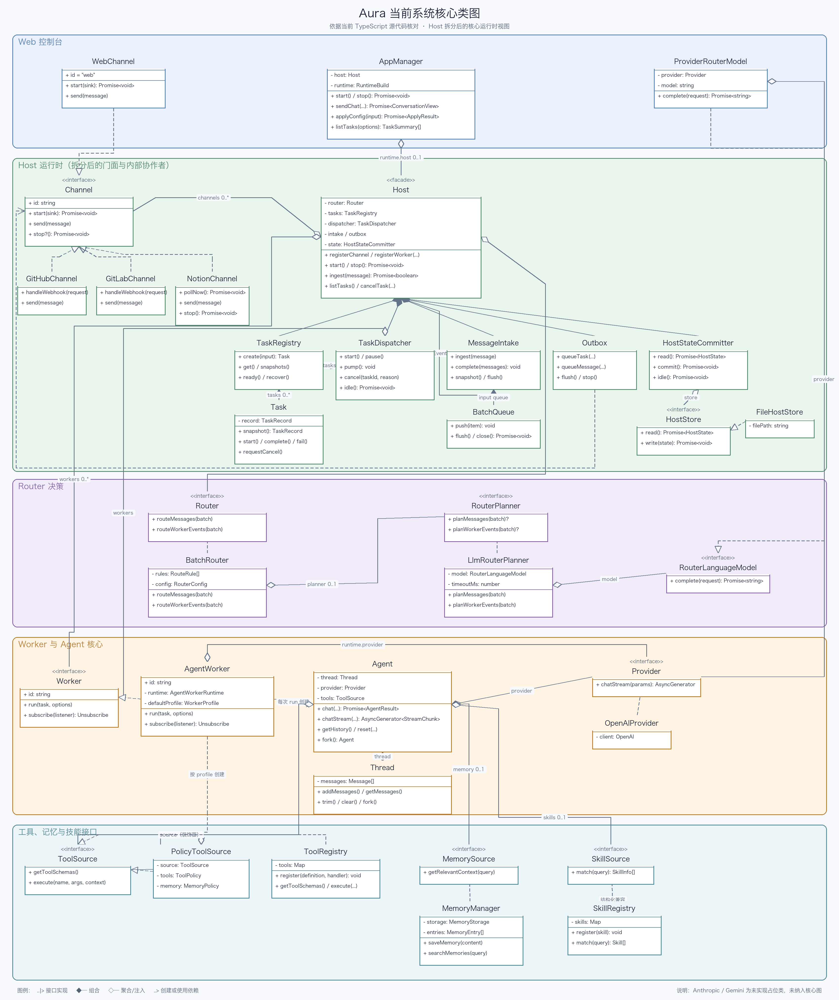

# Aura 当前系统核心类图

> 依据当前工作区的 TypeScript 源代码手工核对绘制，而非仅按目录或 README 推断。

文件：

- [可编辑 Mermaid 图源](./aura-class-diagram.mmd)
- [SVG 矢量图](./aura-class-diagram.svg)
- [PNG 高清图](./aura-class-diagram.png)

## 阅读重点

1. **Web 控制台**：`AppManager` 是 `Host` 生命周期和配置的权威；`WebChannel` 实现统一渠道接口；`ProviderRouterModel` 让 Router 复用 Worker 的模型 Provider。
2. **Host 门面**：`Host` 负责生命周期、渠道/Worker 注册和 Router 决策协调；不再直接承担全部任务、输入、输出和持久化细节。
3. **Host 内部协作者**：`Task` 是拥有状态机与运行不变量的任务聚合；`TaskRegistry` 管理任务集合；`TaskDispatcher` 负责并发调度、Worker 调用和取消；`MessageIntake` 负责 inbox、去重与输入组批；`Outbox` 负责输出投递和渠道故障隔离；`HostStateCommitter` 是唯一持久化提交点，通过 `HostStore` 串行写入完整状态。
4. **Router 决策**：`BatchRouter` 实现 `Router`；规则与确定性回退优先，可选的 `RouterPlanner` 由 `LlmRouterPlanner` 实现，后者通过 `RouterLanguageModel` 调用模型。
5. **Worker 执行**：`AgentWorker` 实现统一的 `Worker` 协议，每次 `run()` 创建独立 `Agent`，并按 profile 创建 `PolicyToolSource`，从而隔离并发对话历史并执行工具权限控制。
6. **Agent 内部**：`Agent` 组合一个 `Thread`，依赖 `Provider`、`ToolSource`、可选 `MemorySource` 和 `SkillSource`，具体能力均可替换。
7. **能力实现**：`ToolRegistry`、`MemoryManager`、`SkillRegistry` 分别提供工具、记忆与技能能力。MCP、文件记忆存储等次要实现未放入核心图。

## 图例

- 空心三角虚线 `..|>`：接口实现。
- 实心菱形 `*--`：组合，内部对象由拥有者创建或管理。
- 空心菱形 `o--`：聚合/持有，通常由构造器或配置注入。
- 普通虚线箭头 `..>`：创建或使用依赖。
- `0..1`、`0..*`、`1`：对象数量；`Host` 持有 worker 事件队列，`MessageIntake` 持有输入队列，二者各使用一个 `BatchQueue`。

## 范围说明

- 图中保留 35 个后端核心类/接口和 42 条主要关系；省略纯 DTO、前端函数组件、测试替身、辅助监控类、原生工具函数和 webhook 服务函数。
- `SkillRegistry` 未显式书写 `implements SkillSource`，但其 `match()` 结构与该接口兼容，并在运行时装配中作为 `SkillSource` 使用，因此图中以接口实现表示 TypeScript 的结构化类型关系。
- `AnthropicProvider` 与 `GeminiProvider` 当前是会抛出“尚未实现”错误的占位实现，未纳入核心图；当前可用模型实现为 `OpenAIProvider`。
- `MemoryHostStore` 是默认/测试存储，Web 运行时装配使用 `FileHostStore`。

## 主要代码依据

- 协议接口：`packages/protocol/src/types.ts`
- Host：`packages/host/src/host.ts`、`task.ts`、`task-registry.ts`、`task-dispatcher.ts`、`message-intake.ts`、`outbox.ts`、`state-committer.ts`、`store.ts`、`channel.ts`、`batch-queue.ts`
- Router：`packages/router/src/batch-router.ts`、`llm-planner.ts`、`types.ts`
- Worker：`packages/worker/src/runtime/agent-worker.ts`、`policy.ts`
- Agent 与能力：`packages/worker/src/agent/agent.ts`、`thread.ts`、`capabilities/`
- Web 装配：`apps/web/src/runtime.ts`、`app-manager.ts`、`web-channel.ts`
